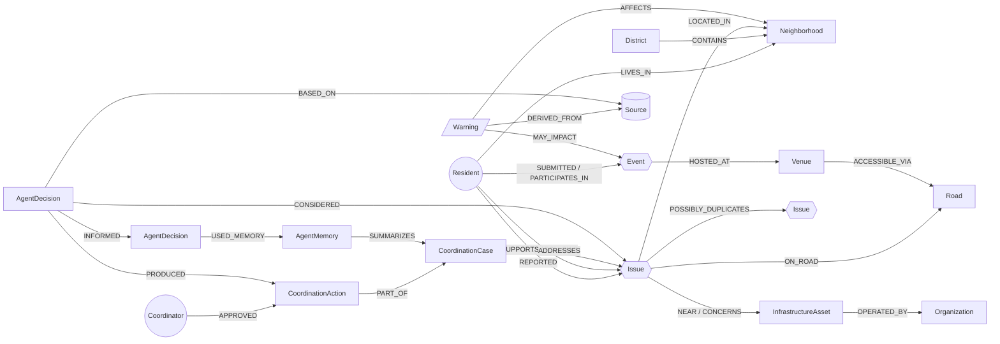

# CityPulse Delhi

**A graph-powered civic and community coordination platform for Delhi, built on FalkorDB.**

Residents discover what's happening around them, report issues, corroborate each other's reports, organise events and see source-backed official alerts. Coordinators investigate connected incidents with AI agents whose every conclusion is traceable to a Cypher query, and whose memory of past decisions lives in the graph.

Built for **Graph Hacks: Context for AI Agents** (WeMakeDevs × FalkorDB, Oct 15–18 2026).

| Track | How CityPulse addresses it |
|---|---|
| **Primary — Agents That Act on Connected Data** | Four LangGraph agents read FalkorDB through typed graph tools, propose coordination actions, and — after human approval — act on the graph (link duplicates, notify residents and organisers, post community updates). |
| **Secondary — Agent Memory and Coordination** | Agent decisions, hand-offs (`INFORMED`), approvals (`APPROVED`), outcomes and `AgentMemory` nodes persist in FalkorDB. New reports retrieve prior cases by graph traversal (Query F), and that memory changes what the agents recommend. Verified to survive API restarts. |

---

## What's real (and what isn't)

- **No fabricated city data.** The production graph contains only: OpenStreetMap geography for the NCT of Delhi (580 neighbourhoods, 13 districts, 2,983 infrastructure assets, 588 OSM operator tags), official CAP alerts from NDMA SACHET when they cover Delhi, and genuine submissions made through CityPulse.
- **Empty states are honest.** When no Delhi alert is active or no one has reported nearby, the UI says so.
- **No fake official integrations.** Reports are "Submitted to CityPulse community". Nothing is filed with MCD, NDMC, DJB, PWD or Delhi Police; CityPulse references (`CP-…`) are labelled as not official complaint numbers.
- **Provenance everywhere.** Every node/edge carries a source and a verification status: `OFFICIAL_VERIFIED`, `SOURCE_VERIFIED`, `COMMUNITY_REPORTED`, `COMMUNITY_CORROBORATED`, `RULE_INFERRED` (deterministic graph/geo rule, with its `basis`), `AI_INFERRED`, `EXPIRED`.
- Test fixtures exist only in isolated test graphs (`citypulse_test`, `citypulse_e2e`), never in the production graph.

## Demo scenario: "the headliner cancels" (synthetic, clearly flagged)

`/command/demo` is a guided control room that shows people, professions, a complaint, an event and a solution connected in the graph, with agents taking **real actions**. It uses **seven fictional personas** (three artists, an organiser, two attendees, one double-booked comedian) in real OpenStreetMap neighbourhoods. Every node it creates carries `demo = true`, titles say "(demo scenario)", and **Remove demo data** deletes all of it.

1. **A booked performer cancels** (`FEATURES {status:'cancelled'}`, `Event.performer_gap = true`). Participants are notified.
2. **The agents wake up on their own.** Context → Impact → Memory → Coordination (LangGraph, `agents/event_workflow.py`). The Impact Agent runs **Query G**: artists who opted in to fill-in gigs, live within 15 km, share the cancelled performer's discipline or artistic *family* (music / visual / performance) via `(:Resident)-[:PRACTICES]->(:Profession)`, and — by traversing `(:Event)-[:FEATURES]->(:Resident)` — have **no overlapping booking**. Every candidate is explained; the double-booked comedian is excluded with the clashing event named.
3. **The agents act.** They `INVITE` the top two artists (graph edges + in-app notifications), notify attendees and the organiser, and open a coordination case. Because the organiser pre-authorised autopilot for this event, this runs *without a coordinator click*, recorded as `(Resident)-[:AUTHORIZED {basis:'event_autopilot'}]->(CoordinationAction)`. Without autopilot the same actions are only **proposed** for coordinator approval (tested).
4. **An attendee complains**; the complaint is linked to the event (`ABOUT_EVENT`) and attached to the running case.
5. **An artist steps in** ("I can step in" on the event page, available to any invited real user): `FEATURES {role:'replacement'}`, gap closed, everyone notified, case resolved, complaint closed, and the **Memory Agent** stores what worked. **Query H** retrieves it the next time a performer cancels.

**You are the organiser.** If a real (non-demo) profile exists, it becomes the organiser of the demo event, so the whole story plays out in your own account: you see the event, the *Organiser controls* (agent autopilot switch and "A booked performer has cancelled"), and your notification bell fills up as the agents act for you. Personas can still be viewed with *View CityPulse as…* in the control room.

Real residents can use the same flow: Profile → *Work & availability* (profession + "open to fill-in performances").

## Why FalkorDB is essential

| Capability | Graph mechanism |
|---|---|
| Radius discovery | `distance()` on indexed `point` properties selects candidates, then traversals add reporter attribution, corroboration, coordination and viewer relationships |
| Duplicate detection | Query B ranks reports by shared `Road`, shared `InfrastructureAsset`, same `Neighborhood`, same category — and writes `POSSIBLY_DUPLICATES` edges with reasons |
| Warning impact | Query C: `Warning-AFFECTS→Neighborhood←LOCATED_IN-Event/Issue/Asset`, `Warning-AFFECTS→Road←ACCESSIBLE_VIA-Venue←HOSTED_AT-Event` |
| Responsible organisation | Query D uses only explicit sourced edges (`OPERATED_BY` from OSM operator tags) — never geographic containment |
| Coordination network | Query E: supporters, followers, linked reports, cases, actions |
| Replacement matching | Query G: `Resident-[:PRACTICES]->Profession` family match + `Event-[:FEATURES]->Resident` time-overlap exclusion, with per-candidate reasons |
| Agent memory | Query F: variable-length traversal `(issue)-[:POSSIBLY_DUPLICATES|ON_ROAD|CONCERNS|NEAR|LOCATED_IN*1..2]-(prior)` → `CoordinationCase` → `AgentMemory`, `CoordinationAction`, `Coordinator` |
| Explainability | Every agent path cites its query file; decisions link to `Source`s, considered entities and used memories |

If FalkorDB is down, every graph endpoint returns **HTTP 503 `graph_unavailable`** — there is no fallback to PostgreSQL (see `apps/api/tests/test_graph_dependency.py`).

The canonical queries live in [`graph/queries/`](graph/queries) and are **loaded by the API at runtime**, so the documented Cypher is exactly what runs.

---

## Architecture

```
apps/web  (Next.js 16, React 19, Tailwind 4, TanStack Query, Zustand, Mapbox GL, Cytoscape)
   │  same-origin proxy /api/v1/* (HTTP-only signed cookies stay first-party)
apps/api  (FastAPI, Pydantic v2, LangGraph agents)
   ├── FalkorDB   — the city graph: residents, places, reports, events, alerts, coordination, agent memory
   └── PostgreSQL — operational only: hashed session tokens, operator sessions, audit log, source runs, notifications
```

A modular monolith: one API process, one web process, two databases, a background thread that refreshes the SACHET feed every 15 minutes.

### Experiences
- **Residents** — Home, Explore (map), Around You (radius community network), Report, Issues, Events, Warnings, My Activity, City Connections (graph explorer), Profile & privacy, About.
- **CityPulse Command** (`/command`) — Overview, Incident queue + investigation (run agents, approve/reject, record outcomes), Coordination cases, Event coordination, Warning intelligence, Graph investigation, Agent activity (decision traces), City memory, Source health.
- **Organisers** — create events, see participants by role, post updates (notifies participants), see overlapping official alerts and nearby reports.

### Agents (LangGraph: `apps/api/app/agents/workflow.py`)
1. **Context Agent** — resolves the report to neighbourhood, district, OSM road, nearby assets; flags ambiguity.
2. **Impact Agent** — related reports (B), active alerts, events within 2 km, operators (D), coordination network (E); builds explanation paths.
3. **Memory Agent** — retrieves prior cases/outcomes (F) and recurrence; after outcomes are recorded, writes `AgentMemory`.
4. **Coordination Agent** — proposes actions (link duplicates, request verification/info, publish update citing the official source, contact organiser, reuse what worked before).

Each run writes four `AgentDecision` nodes chained by `INFORMED`. Proposals are `CoordinationAction {status:'proposed'}` and are invisible to the public until a coordinator approves. With no LLM key the agents run in **deterministic graph-only mode** and every decision records `model_name = "deterministic-rules (no LLM)"`; with `LLM_PROVIDER=openai|gemini` the LLM only rewrites summary/messages, with untrusted text passed as data and output validated. "Evidence strength" is a count of independent graph routes, explicitly *not* a calibrated probability.

---

## Graph data model

See [`docs/architecture/graph-model.md`](docs/architecture/graph-model.md) for every label, property and relationship with its provenance. Summary:

```
(Resident)-[:LIVES_IN]->(Neighborhood)<-[:CONTAINS]-(AdministrativeArea {district})<-[:CONTAINS]-(AdministrativeArea {NCT})
(Resident)-[:REPORTED {anonymous}]->(Issue)-[:LOCATED_IN]->(Neighborhood)
(Issue)-[:ON_ROAD]->(Road)   (Issue)-[:NEAR|CONCERNS]->(InfrastructureAsset)-[:OPERATED_BY]->(Organization)
(Issue)-[:POSSIBLY_DUPLICATES {score, reasons}]->(Issue)
(Resident)-[:SUPPORTS|FOLLOWS]->(Issue)      (Resident)-[:COMMENTED_ON]->(Discussion)-[:ABOUT]->(Issue|Event)
(Resident)-[:SUBMITTED|PARTICIPATES_IN {role}]->(Event)-[:HOSTED_AT]->(Venue)-[:ACCESSIBLE_VIA]->(Road)
(Event)-[:ORGANIZED_BY]->(Organization)       (Warning)-[:AFFECTS]->(Neighborhood|AdministrativeArea)
(Warning)-[:MAY_IMPACT]->(Event)              (Warning|Neighborhood|Asset|Road)-[:DERIVED_FROM]->(Source)
(CoordinationCase)-[:ADDRESSES]->(Issue)      (CoordinationAction)-[:PART_OF]->(CoordinationCase)
(Coordinator)-[:APPROVED]->(CoordinationAction)
(AgentDecision)-[:CONSIDERED|BASED_ON|USED_MEMORY|PRODUCED|INFORMED]->(…)
(AgentMemory)-[:SUMMARIZES]->(CoordinationCase)   (AgentMemory)-[:RECORDS]->(CoordinationAction)   (AgentMemory)-[:LEARNED_FROM]->(AgentDecision)
```

Indexes: every stable ID, plus status, timestamps, `osm_ref`, and **point indexes on `location`** for Issue, Event, Neighborhood, Venue, InfrastructureAsset, Resident (`graph/schema/schema.cypher`). Verified on FalkorDB 4.22.

### Graph diagram



**How the agents use it:** the Impact Agent runs Queries B/C/D/E (shared road, alert paths, sourced operators, coordination network); the Memory Agent runs Query F, which walks `Issue-[POSSIBLY_DUPLICATES|ON_ROAD|NEAR|LOCATED_IN*1..2]-Issue<-ADDRESSES-CoordinationCase<-SUMMARIZES-AgentMemory`; the Coordination Agent turns those results into proposed `CoordinationAction`s. Each decision stores its query ids and paths, shown under **Agent activity** in `/command`.

## Privacy

- Name, email and address are stored on the private `Resident` node; **all public output passes a per-label property allowlist** (`apps/api/app/graph/model.py`). Email, address and coordinates are never returned to anyone but the owner.
- Public report locations are generalised (~100 m grid or neighbourhood centre). The Around You centre is resolved server-side from your home and only the neighbourhood centre is returned; distances are bucketed.
- Profiles are private by default; names appear only with explicit opt-in; any report can be anonymous. Private residents appear in the graph explorer as throwaway `anon_…` nodes that can't be expanded or linked across views.
- **Quick profiles are not identity.** No email lookup or recovery exists, so typing someone's email unlocks nothing (`test_email_does_not_unlock_existing_profile`). Session token = signed HTTP-only cookie; only its SHA-256 is stored.
- Delete profile removes the resident node and comments; reports remain as unattributed civic records. Export your data from Profile.
- Operators use separate PBKDF2 accounts and short-lived sessions; approvals, rejections, outcomes, logins and source refreshes are audited.
- CSRF header guard, CORS restricted to the web origin, write rate limiting, parameterised Cypher only, **no endpoint executes caller-supplied Cypher**, FalkorDB browser bound to localhost.

## Data sources

Full manifest with licence, access method and limitations: [`data/manifests/sources.json`](data/manifests/sources.json) (also shown at `/about` and `/command/sources`).

| Source | Status | Notes |
|---|---|---|
| OpenStreetMap via Overpass | Ingested | ODbL; neighbourhoods, district boundaries (containment computed by Overpass), metro stations, hospitals, police/fire stations, public toilets, parks, operator tags |
| OSM Nominatim | Live, per report | Nearest named road; 1 req/s, identifying User-Agent |
| NDMA SACHET CAP feed | Ingested every 15 min | Official alerts (IMD, SDMAs); feed declares public domain. Kept only when the CAP area resolves to Delhi districts/neighbourhoods. The polygon endpoint returns 403 to automated clients and is **not** used |
| Mapbox | Display / search | Map tiles, address search (requires token) |
| Delhi Traffic Police, Delhi Tourism, data.gov.in | Evaluated, not ingested | No machine-readable access or reuse licence found (DTP, Tourism); data.gov.in needs per-dataset validation |

On 16 Oct 2026 no SACHET alert covered Delhi, so the Warnings page correctly shows none. The pipeline is tested with a CAP-format document in the test graph.

---

## Running locally

Prerequisites: Docker, Node 22+, [uv](https://docs.astral.sh/uv/) (Python 3.12 is installed by uv).

```bash
cp .env.example .env
# set SESSION_SECRET, NEXT_PUBLIC_MAPBOX_TOKEN, and an operator:
cd apps/api && uv sync && uv run python -m app.security.hash_password coordinator   # paste into OPERATOR_ACCOUNTS

docker compose up -d falkordb postgres          # FalkorDB :6379, Postgres :55432

cd apps/api
uv run python -m app.ingestion.run all          # OSM (cached in data/cache) + SACHET
uv run uvicorn app.main:app --port 8000 --timeout-keep-alive 75   # keep-alive > the web proxy idle time

cd apps/web && npm install && npm run dev       # http://localhost:3100
```

Everything in containers: `docker compose --profile app up --build` (web on :3100, API on :8000).

Without a Mapbox token, maps show a notice and address search falls back to Nominatim; everything else, including radius discovery, works.

### Tests

```bash
cd apps/api && uv run pytest        # 24 integration tests against a real FalkorDB (isolated graph)
cd apps/web && npx tsc --noEmit
# E2E against an ISOLATED stack (separate graph citypulse_e2e):
#   FALKORDB_GRAPH=citypulse_e2e DATABASE_URL=sqlite:///e2e.db uv run uvicorn app.main:app --port 8001
#   NEXT_DIST_DIR=.next-e2e API_INTERNAL_URL=http://127.0.0.1:8001 npx next dev -p 3200
#   E2E_OPERATOR_PASSWORD=… npx playwright test
```

Covered: graph-down → 503; contributors never leak email/address/coordinates; email can't unlock another profile; radius correctness (1 km vs 3 km vs 20 km); idempotent support + corroboration threshold; duplicate detection via shared road; CSRF; operator-only coordination; agent hand-off chain; approved action → outcome → memory → **retrieved after a fresh connection** and changing the next recommendation; CAP parsing, Delhi filtering and full provenance; events (attestation, organiser-only contact and updates). The Playwright test drives the whole resident → coordinator → memory flow through the UI.

## Known limitations

- Report image upload is not implemented yet.
- No real events are ingested from external sources (none with permitted machine access were found); events are genuine resident/organiser submissions.
- Warning-to-area matching uses CAP `areaDesc` text against OSM names because SACHET polygons are blocked to automated clients.
- Road linking depends on Nominatim (best effort; a report still saves if it fails).
- Rate limiting is in-memory (single process). PostgreSQL tables are created at startup; Alembic migrations are not yet generated.
- Quick profiles are browser-bound; clearing cookies loses access by design.

## Repository map

```
apps/api/app/{api,agents,graph,ingestion,security,services,db,schemas}   apps/api/tests
apps/web/{app,components,features,hooks,lib,e2e}
graph/queries (A–F, executed at runtime)   graph/schema   data/manifests   docs/   AI_USAGE.md
```

See also [AI_USAGE.md](AI_USAGE.md), [CONTRIBUTING.md](CONTRIBUTING.md), [decision log](docs/decisions/log.md), [demo script](docs/demo/demo-script.md).
